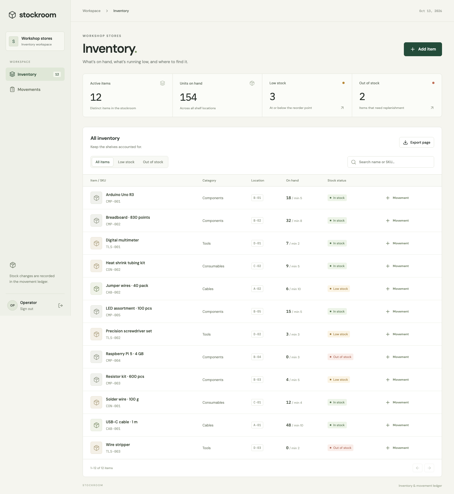
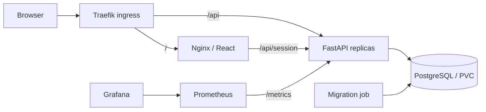

# Stockroom

[](https://github.com/adityabhas22/stockroom/actions/workflows/ci.yml)

Inventory for a shared workshop. Track parts by SKU and shelf, receive deliveries, issue stock, and keep the movement history after an item is archived.



## Run locally

Docker Desktop or Docker Engine with Compose is required.

```sh
docker compose up --build
```

Open [localhost:3000](http://localhost:3000). The local workspace password is `stockroom-local`.

The database starts empty. Load the optional workshop dataset from another terminal:

```sh
python3 scripts/seed.py
```

The seed creates 12 items. Its opening receipts use fixed request IDs, so running it twice does not add stock twice. All sample receipts are labelled in the ledger.

Local ports are bound to loopback. The Compose defaults are for local development; Kubernetes uses a separately generated Secret.

```sh
docker compose down       # stop; keep inventory
docker compose up -d      # resume
```

`docker compose down -v` also deletes the database. Make a backup first if the data matters.

## Working with inventory

- **Add item** creates a SKU with zero stock, a shelf location, and a reorder point.
- **Record movement** receives or issues units. Every movement requires a reason or reference.
- An item is **low stock** when its positive balance is at or below its reorder point. A zero balance is **out of stock**.
- Select an item name to see its recent history or edit its details.
- An item can be archived only when its balance is zero. Its SKU stays reserved and its history stays in the ledger.
- **Export page** downloads the currently displayed inventory page as CSV.

Stock cannot be edited directly. Concurrent issues serialize on the item row, and a repeated movement request returns the original result. Stale detail edits return a conflict instead of overwriting newer changes.

## Stack

| Layer | Implementation |
| --- | --- |
| Interface | React, TypeScript, Vite, Nginx |
| API | FastAPI, SQLAlchemy, Psycopg |
| Database | PostgreSQL 17, Alembic |
| Tests | Pytest against PostgreSQL; Playwright in Chromium |
| Delivery | GitHub Actions, Trivy, GHCR, commit-SHA image tags |
| Infrastructure | Terraform, AWS VPC, EKS managed nodes, EBS CSI |
| Workloads | Helm, Deployments, StatefulSet, Ingress, HPA |
| Monitoring | Prometheus Operator, Grafana, application alerts |



The exact `/api/session` ingress route goes through Nginx to apply the login rate limit. Other API routes go directly to the backend Service. Health and metrics endpoints are not exposed by ingress.

## Tests

Backend tests use a dedicated database whose name must end in `_test`. The test helper starts an ephemeral PostgreSQL instance on port 55432 and removes it on exit.

```sh
cd backend
python3.12 -m venv .venv
.venv/bin/pip install -r requirements-dev.txt
cd ..
./scripts/test.sh
```

The suite covers authentication, validation, CRUD, filters, stock balances, audit records, stale edits, database constraints, concurrent issues, and concurrent retries. It also checks migration drift and a downgrade/upgrade round trip.

With the Compose application running:

```sh
cd frontend
npm ci
npx playwright install chromium
npm run build
npm run test:e2e
```

Browser tests create and archive their own items. Their movement records remain visible in the ledger. `BASE_URL` selects a different deployment.

## Local Kubernetes

Requires Docker, kind, kubectl, Helm 3, and OpenSSL. The script creates a cluster named `stockroom`, builds and loads the images, installs Traefik and Metrics Server, and installs the application chart.

```sh
./scripts/local-cluster.sh
python3 scripts/seed.py --url http://stockroom.localhost:8088
```

Open [stockroom.localhost:8088](http://stockroom.localhost:8088). If the system resolver does not resolve `.localhost`, use:

```sh
curl -H 'Host: stockroom.localhost' http://localhost:8088
```

The cluster password defaults to `stockroom-local` on the first installation. Set `OPERATOR_PASSWORD` before running the script to use another password. Re-running preserves the existing Secret and database.

Install monitoring in that cluster:

```sh
kubectl config use-context kind-stockroom
export GRAFANA_PASSWORD='choose-a-local-password'
./scripts/monitoring.sh
helm upgrade stockroom helm/stockroom -n stockroom \
  --reuse-values --set monitoring.enabled=true \
  --wait --wait-for-jobs
kubectl -n monitoring port-forward svc/monitoring-grafana 3001:80
```

Grafana is at [localhost:3001](http://localhost:3001), with username `admin`. Open **Stockroom / Application**. Read traffic can be generated with `scripts/load.py`; see the [operations runbook](docs/runbook.md).

## API

Local OpenAPI documentation: [localhost:8000/docs](http://localhost:8000/docs).

| Method | Path | Purpose |
| --- | --- | --- |
| POST / GET / DELETE | `/api/session` | Sign in, check session, sign out |
| GET / POST | `/api/items` | List or create items |
| GET / PUT / DELETE | `/api/items/{id}` | Read, edit, or archive an item |
| POST | `/api/items/{id}/movements` | Receive or issue stock |
| GET | `/api/movements` | Paginated movement ledger |
| GET | `/api/summary` | Active items, units, low stock, empty items |
| GET | `/health` | Process liveness and image revision |
| GET | `/ready` | Database and schema readiness |
| GET | `/metrics` | Prometheus metrics |

All inventory APIs require a session cookie. Mutating requests also require `X-Stockroom-Request: 1`. Sessions expire after eight hours. No cross-origin browser access is enabled.

## Deployment and operations

- [Architecture decisions](docs/architecture.md)
- [AWS and GitHub deployment](docs/deployment.md)
- [Backups, alerts, scaling, rollback, and failure labs](docs/runbook.md)
- [Recorded verification](docs/verification.md)
- [AWS execution and screenshot index](docs/aws-run.md)
- [Video walkthrough](stockroom-walkthrough.mp4)
- [Visual evidence index](review.html)

The course architecture is described in the [DevOps capstone brief](https://github.com/Nency-Ravaliya/devops-heros/tree/main/session21-python). The application, tests, and deployment configuration here implement the workshop inventory domain.
