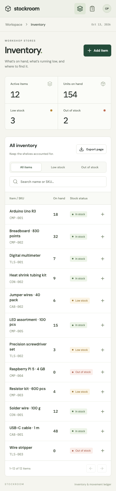
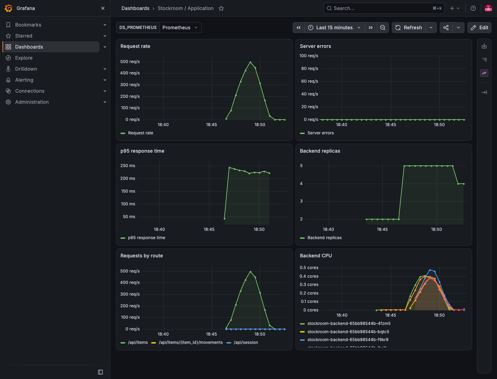
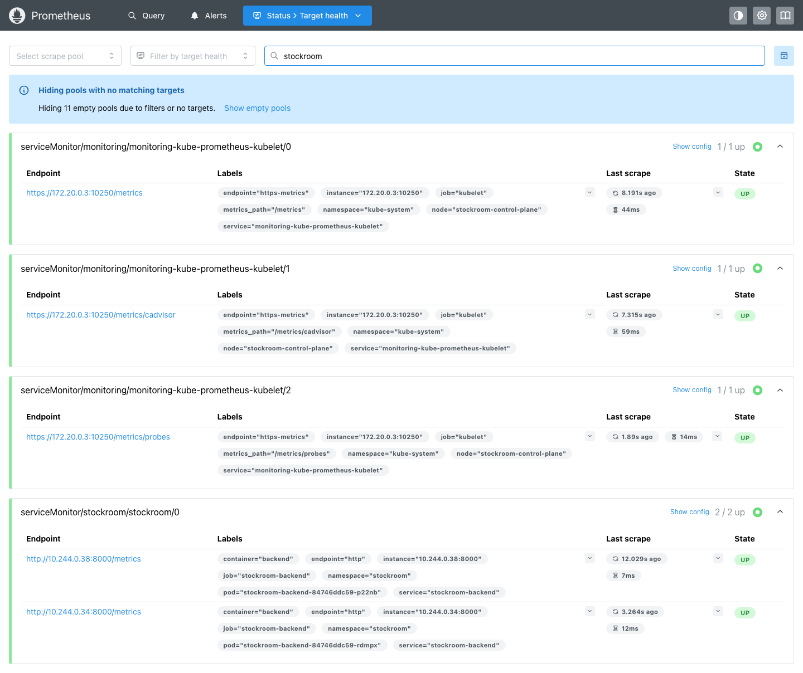

# Verification

Recorded on 13 October 2026 on macOS, Docker Desktop, and a local kind cluster running Kubernetes 1.32.2. These results describe that environment; they are not AWS deployment results.

| Check | Result | Record |
| --- | --- | --- |
| PostgreSQL API tests | 21 passed | [Output](evidence/backend-tests.txt) |
| Migration consistency | No model drift; downgrade and upgrade completed | [Output](evidence/backend-tests.txt) |
| Chromium on Compose | 3 passed | [Output](evidence/browser-compose.txt) |
| Chromium through Kubernetes ingress | 3 passed | [Output](evidence/browser-kubernetes.txt) |
| Frontend compilation | TypeScript and Vite build completed | Reproduced in both Docker builds |
| Compose startup | Database, API, and frontend healthy; migration completed | [Services](evidence/compose.txt) |
| Helm deployment | Application and monitoring installed | [Resources](evidence/kubernetes.txt) |
| AWS chart resources | Accepted by Kubernetes server dry run | [Output](evidence/manifest-validation.txt) |
| Terraform | Init, validate, and one mocked plan test passed | [Output](evidence/terraform.txt) |
| GitHub workflow syntax | Actionlint passed | `.github/actionlint.yaml` includes the custom runner label |
| Container scanning | No HIGH or CRITICAL findings in either final application image | [Scan summary and image IDs](evidence/security-scans.json) |
| Prometheus scraping | Application targets UP | [Targets](evidence/prometheus-targets.json) |
| Autoscaling | Backend increased from 2 to 5 replicas under load, then returned to 2 | [HPA observations](evidence/autoscaling.txt) |
| Load generation | 76,855 successful reads; 0 failures over 180 seconds with 24 workers | [Result](evidence/load.json) |
| Database outage | `/health` returned 200; `/ready` returned 503; readiness recovered after restart | [Output](evidence/database-outage.txt) |
| PostgreSQL pod replacement | Inventory remained at 12 active items and 154 units | [Output](evidence/postgres-persistence.txt) |
| Backup restore | Archive restored into a separate database; 14 item rows and 12 movements recovered | [Counts](evidence/restore.txt) |
| Failure exercises | Bad image reproduced and corrected; empty Service endpoints reproduced and corrected | [Output](evidence/failure-labs.txt) |

The backup includes two archived test items. The active sample inventory contains 12 items and 154 units. Browser tests leave their own archived items and movement records, so later database counts can increase.

The backend test run emits a dependency deprecation warning about Starlette's HTTPX test client. It does not fail the suite. The runtime does not use that test client.

## Interface

The desktop and mobile captures show the running application with the optional seed dataset. Fonts are bundled locally; the interface makes no font requests to an external service.

## Monitoring

The Grafana capture contains application traffic, latency, CPU, and the increase to five backend replicas. Grafana's initial 256 MiB memory limit caused an OOM restart during dashboard loading. The final configuration uses a 768 MiB limit, and the replacement pod loaded all six panels successfully.

## Not executed

- Publishing this repository to GitHub and running the workflow on GitHub-hosted infrastructure.
- Publishing the application images to GHCR.
- An authenticated AWS Terraform plan, apply, or destroy.
- Deploying to EKS through the OIDC deployment job.
- External TLS, public DNS, and public load-balancer access.

The configuration and commands for those steps are in [deployment.md](deployment.md). Terraform's mocked test evaluates the resource configuration; it does not contact AWS or prove account permissions, regional capacity, or successful teardown. Local Trivy results do not substitute for a future CI scan because vulnerability databases and base-package updates change over time.
